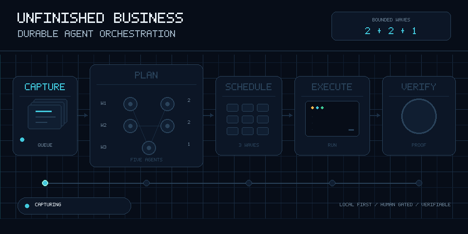
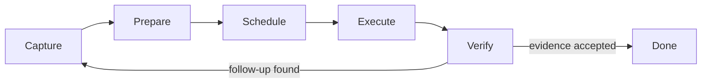

# Unfinished Business

**A durable, local-first work queue for Claude Code. Capture every loose end, prepare it outside the active session, execute from a shared queue, and verify before closing.**

<picture>
  <source media="(prefers-reduced-motion: reduce)" srcset="./.github/assets/agent-orchestration-poster.png">
  
</picture>

> [!IMPORTANT]
> This is an early public release. It is Windows-first, expects Node.js 22 or newer and Claude Code, and should be evaluated on a non-critical project before wider use.

## Why it exists

Long agent sessions tend to lose small discoveries, duplicate work after context resets, or declare victory while follow-ups are still scattered through chat. Unfinished Business turns those loose ends into one durable queue shared by the operator and Claude.

- Capture discovered work immediately, including when the server is temporarily unavailable.
- Prepare larger tasks in separate Claude Code sessions so the active session stays focused.
- Order independent work into bounded parallel waves and serialize fragile dependencies.
- Pause at safe boundaries, persist a handoff, and resume after `/clear`.
- Require verification evidence before a task can become `done`.
- Inspect and control the queue from a build-free localhost UI.

Queue data stays on the machine. The dashboard has no analytics, remote fonts, or CDN scripts. Optional preparation and council features invoke the locally installed Claude Code CLI and therefore use whatever provider configuration that CLI already has.

## Install

Requirements:

- Claude Code
- Node.js 22+
- Windows 11 is the primary tested platform for this release

Clone the repository, review the installer, then run:

```powershell
gh repo clone OWNER/unfinished-business
cd unfinished-business
node install.mjs
```

The installer copies the app to `~/.claude/unfinished-business/` and the skill to `~/.claude/skills/unfinished-business/`. It does not install npm dependencies.

In any project, invoke:

```text
/unfinished-business
```

Optional setup for separate-session preparation:

```powershell
node "$env:USERPROFILE\.claude\unfinished-business\ub.mjs" login
```

Optional hooks add session-start recovery, a stop guard, collision protection for GSD-style workflows, and captured-signal triage:

```powershell
node "$env:USERPROFILE\.claude\unfinished-business\ub.mjs" hooks install
```

## How it works



The server binds to `127.0.0.1`, stores state outside the repository, and exposes a token-protected API to the CLI and dashboard. The skill drives a simple contract: capture first, select the next executable item, use the right execution engine, verify honestly, and stop only at true quiescence.

## Components

| Path | Purpose |
|---|---|
| `skill/` | Claude Code skill and focused operating references |
| `app/ub-server.mjs` | Local queue, API, scheduling jobs, councils, audit chain, and SSE updates |
| `app/ub.mjs` | Command-line interface used by Claude and scripts |
| `app/hooks.mjs` | Claude Code lifecycle hooks and durable capture spool |
| `app/mcp.mjs` | Optional stdio MCP bridge exposing `ub_*` tools |
| `app/ui/` | Dependency-free local dashboard and original orchestration animation |
| `app/prompts/` | Prompt contracts for preparation, ordering, and councils |

Runtime data is stored under the operating system's local application-data directory, not in the checked-out repository. It survives reinstalls and context resets. Treat that directory as sensitive: it can contain task text, project paths, local tokens, logs, and optional Claude authentication state.

## Common commands

Run commands from the project being managed:

```powershell
$ub = "$env:USERPROFILE\.claude\unfinished-business\ub.mjs"
node $ub ensure
node $ub status
node $ub add "Write the migration test" --context "Found during review"
node $ub list
node $ub verify-audit
```

Run `node $ub help` for the complete CLI surface.

## Security and privacy

- No real names, personal email addresses, phone numbers, street addresses, local home paths, credentials, runtime stores, or private planning artifacts are included in this public history.
- The first public commit was created from a clean export; the private development history was intentionally not published.
- The UI is a local operator console, not a hardened multi-user service. Do not expose its port through a tunnel, proxy, container publish flag, or firewall rule.
- Do not commit runtime data, `server.json`, `auth.json`, audit logs, screenshots containing task content, or project exports without reviewing them.
- See [SECURITY.md](./SECURITY.md) for responsible disclosure and the current support policy.

## Development

The runtime has no production dependencies and no build step.

```powershell
npm test
npm run check
```

To regenerate the README animation, install the pinned media-only dependency and run the renderer:

```powershell
python -m pip install -r requirements-media.txt
python scripts/render_readme_animation.py
```

Contributions are welcome. Start with [CONTRIBUTING.md](./CONTRIBUTING.md). By contributing, you agree that your contribution is licensed under the [MIT License](./LICENSE).

## Scope

Unfinished Business is an orchestration layer, not a replacement for an issue tracker, source control, code review, or Claude Code itself. When a project already has a canonical backlog, the skill mirrors only the slice it is actively driving and preserves the external system as the source of truth.

## License

MIT © 2026 Unfinished Business contributors.
